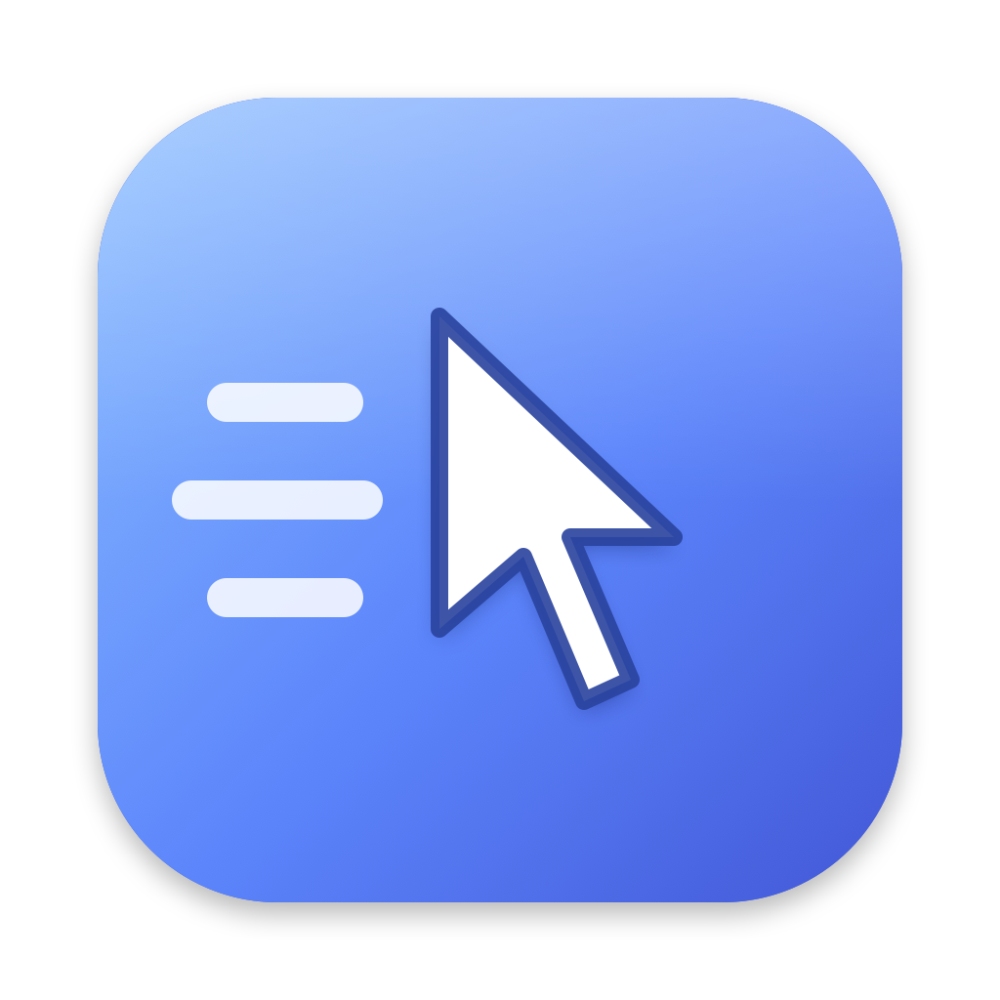
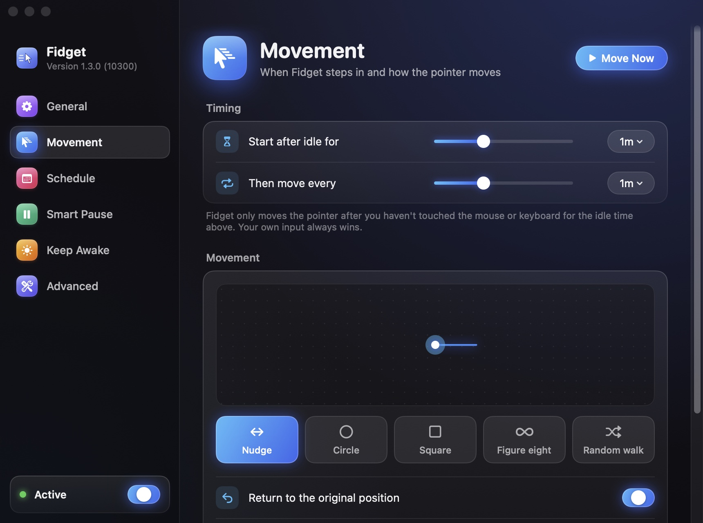
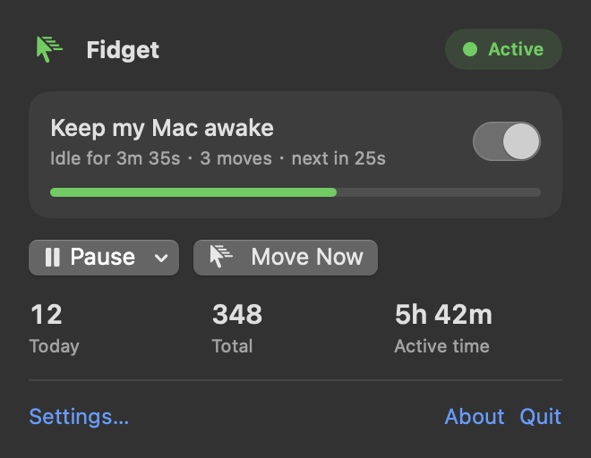
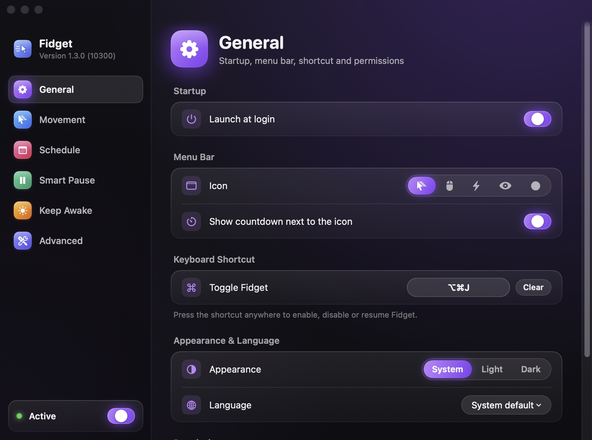
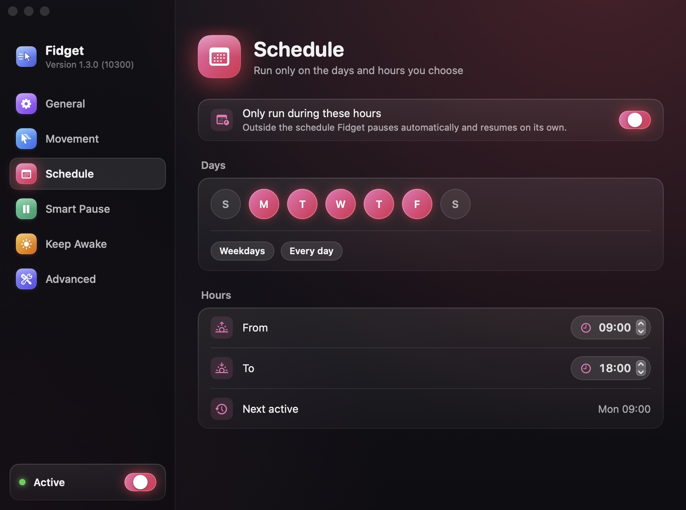
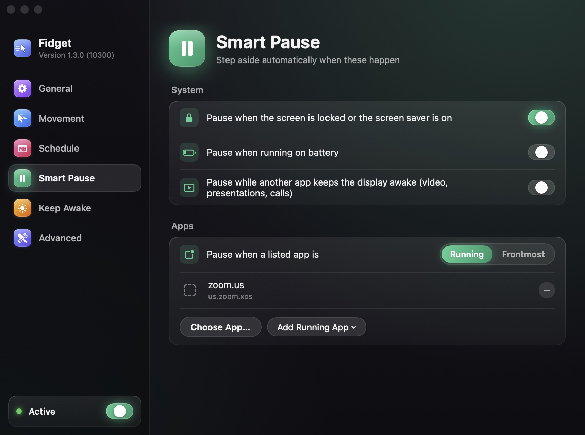
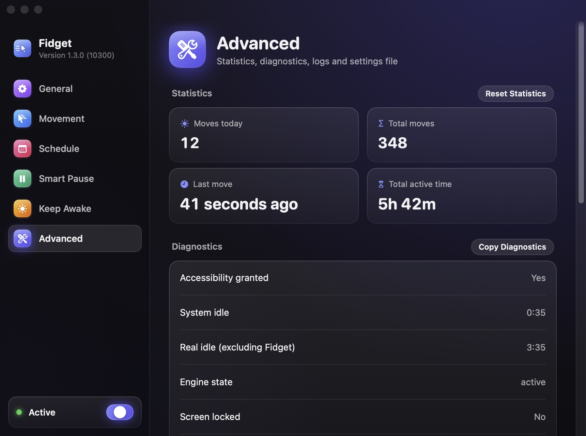
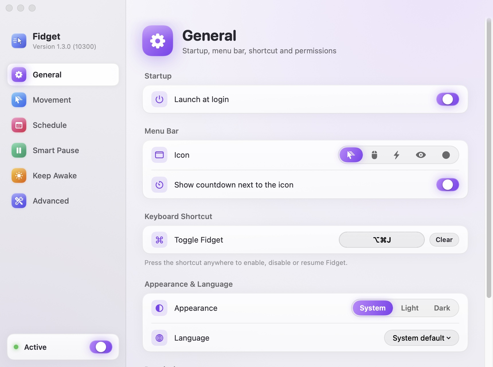
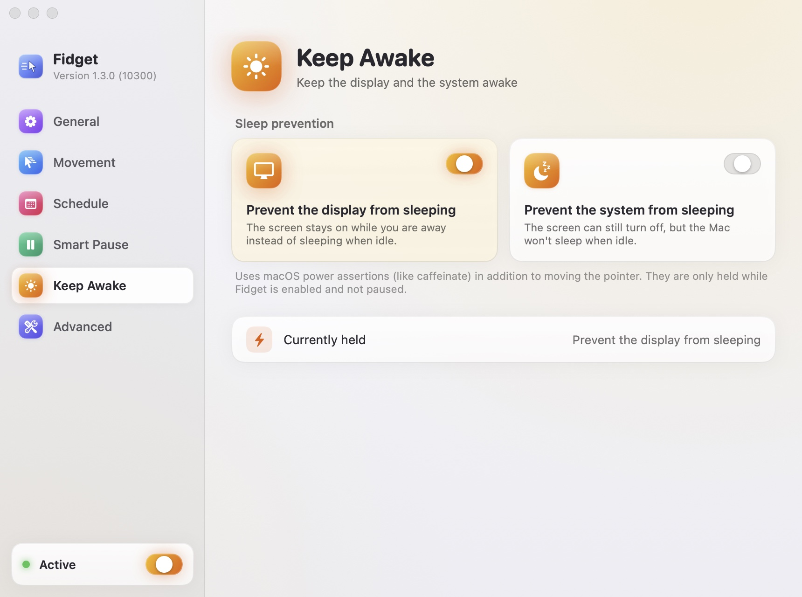

<p align="center">
  
</p>

<h1 align="center">Fidget</h1>

<p align="center">Keeps your Mac awake and your status green with tiny mouse movements while you're away.<br>
Apple Silicon only · macOS 11 Big Sur or later · Swift 6 · automatic updates · open source (MIT)</p>

<p align="center"><b>English</b> · <a href="README.zh-CN.md">简体中文</a></p>

Fidget is a spiritual successor to [automatic-mouse-mover](https://github.com/prashantgupta24/automatic-mouse-mover). The original was written in Go with robotgo and stopped being maintained as Intel Macs faded out. Fidget is a from-scratch rewrite as a native Swift menu bar app that does one thing and does it well.

<p align="center">
  
</p>

## What it does

- **Works only while you're away**: it starts moving the pointer after you've been idle for a while (60 seconds by default) and stops the moment you touch the mouse or keyboard. Its own movements are never mistaken for you coming back.
- **Real HID events**: mouse events are posted through CoreGraphics, so the system idle timer resets and the "away" detection in Slack, Teams, WeCom and the like sees you as active. Tools that only prevent sleep (caffeinate, Amphetamine's default mode) can't do that.
- **Everything is adjustable**: idle threshold, interval, five patterns (nudge, circle, square, figure eight, random walk), distance, duration, returning to the original position, and an invisible mode you can't see with the naked eye.
- **Knows when to stay quiet**: pauses automatically when the screen is locked or the screen saver is on, on battery power, outside your schedule (windows across midnight are supported), while listed apps are running or frontmost, and while another app is playing a video or a presentation.
- **Handy sleep prevention**: optional display and system sleep assertions, held only while Fidget is working.
- **A modern menu bar app**: status icon with a countdown, popover, right-click menu, global shortcut, setup assistant, English and Simplified Chinese, `fidget://` URL automation, and a settings window inspired by CleanMyMac with light and dark appearances.
- **Keeps itself up to date**: checks for a new version once a day. One click downloads it, verifies its signatures, replaces the app and relaunches it, or you can let updates install in the background.
- **Safe and transparent**: no accounts, and the only network access is the daily update check, which you can turn off. Updates are signed with an EdDSA key and must come from the same developer. Settings are a readable JSON file, and diagnostics can be copied with one click.

## Install

### Download

Download `Fidget-<version>.dmg` from [Releases](https://github.com/lacdonlang/fidget/releases) and drag Fidget into Applications. On first launch, follow the setup assistant to grant the **Accessibility** permission (System Settings → Privacy & Security → Accessibility). If Fidget's switch there is already on but the app still says it isn't authorized (this happens after installing an older build that was signed differently), click "Reset Permission" in the popover and turn the switch on again. From then on Fidget updates itself (Settings → Advanced → Updates).

### Build from source

Requires Apple Silicon and Xcode 16 or later (or the matching Command Line Tools).

The app supports every macOS release that runs on Apple Silicon (11 Big Sur and later). Note that Xcode 27 can only deploy to macOS 12 or later, so an app you build locally with it needs macOS 12+. Releases are built on CI with an Xcode that can still deploy to macOS 11 (`scripts/select-xcode.sh`). Run `make check-min-os` to check API availability against macOS 11 locally.

```bash
git clone https://github.com/lacdonlang/fidget.git && cd fidget
make app          # → build/Fidget.app (ad-hoc signed, runs on this Mac)
make run          # build the debug app and launch it
make test         # run all tests
```

Sign with your own Developer ID, notarize, and build a DMG:

```bash
export CODESIGN_IDENTITY="Developer ID Application: Your Name (TEAMID)"
make app notarize dmg
```

To open the project in Xcode, run `make xcodeproj && open Fidget.xcodeproj` (requires `brew install xcodegen`), or simply `open Package.swift`. See [docs/SIGNING.md](docs/SIGNING.md) (in Chinese) for details.

## Usage

<p align="center">
  
</p>

| Action | How |
| --- | --- |
| Turn on / off | Popover switch · right-click menu · global shortcut · `open fidget://toggle` |
| Pause for 15 min / 30 min / 1 hour / … / the rest of the day / until resumed | Popover "Pause" menu · right-click menu · `open "fidget://pause?minutes=30"` |
| Move once right now (to test the permission) | Popover "Move Now" · `open fidget://move` |
| Open Settings | ⌘, in the popover · `open fidget://settings` |

The menu bar icon shows the state: active (filled or with motion lines), watching (plain), paused (pause symbol), needs permission (warning triangle), off (dimmed).

## Screenshots

| General | Schedule |
| --- | --- |
|  |  |

| Smart Pause | Advanced |
| --- | --- |
|  |  |

Light appearance (Settings → General → Appearance: System / Light / Dark):

| General | Keep Awake |
| --- | --- |
|  |  |

The screenshots are generated by `make screenshots`: the app renders them in-process, so no screen recording permission is needed. There is a set for each language and appearance.

## Documentation (in Chinese)

- [Architecture](docs/ARCHITECTURE.md): layers, state machine, telling Fidget's own events apart from yours, concurrency model, decision log
- [Features](docs/FEATURES.md): behavior, defaults and limits of every feature
- [Testing](docs/TESTING.md): test layers, test case lists, manual acceptance checklist
- [Signing and release](docs/SIGNING.md): certificates, notarization, CI, TCC caveats

## Project layout

```
Package.swift            SwiftPM (the single source of truth for code and tests)
Sources/FidgetCore       Pure logic: settings, state machine, patterns, schedule, rules, statistics
Sources/FidgetSystem     macOS adapters: CGEvent, IOKit, screen lock, permissions, login items, hotkeys, persistence, logging
Sources/FidgetApp        SwiftUI views, menu bar controller, composition root, localized resources
Sources/Fidget           Executable entry point
Tests/                   Swift Testing: core unit tests, system integration tests, app-layer tests
Resources/               Info.plist, entitlements, icons and asset catalog
scripts/                 Build / sign / notarize / DMG / icon / smoke test / screenshots
project.yml              XcodeGen configuration (generates Fidget.xcodeproj)
```

## Why not the App Store

The App Store requires the sandbox, and a sandboxed app can't get the Accessibility permission, so it can't post real mouse events. Inside the sandbox, all an app can do is `CGWarpMouseCursorPosition` plus power assertions. That prevents sleep, but chat apps still mark you as away. That's why Fidget is distributed with Developer ID signing and notarization. The `PointerControlling` protocol in the code leaves room for a sandboxed fallback version in the future.

## Credits

Inspired by [Automatic Mouse Mover by Prashant Gupta](https://github.com/prashantgupta24/automatic-mouse-mover). MIT License.
