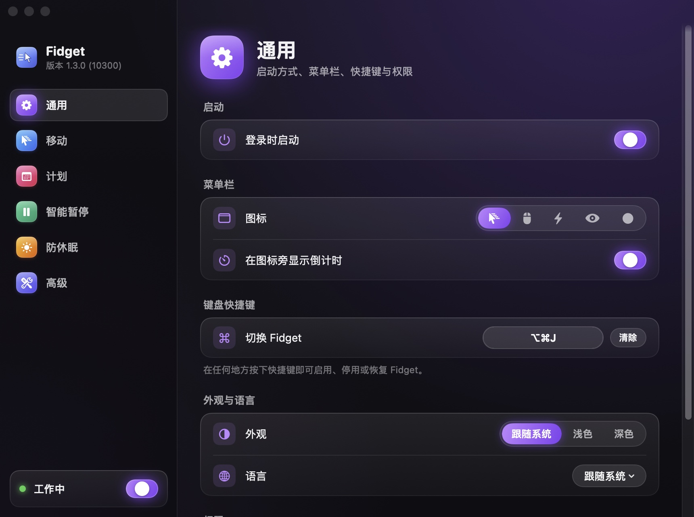

<p align="center">
  
</p>

<h1 align="center">Fidget</h1>

<p align="center">闲时轻轻移动鼠标，让 Mac 保持唤醒、让你的在线状态保持绿色。<br>
仅支持 Apple Silicon · macOS 11 Big Sur 及以上 · 开源（MIT）</p>

<p align="center"><a href="README.md">English</a> · <b>简体中文</b></p>

Fidget 是用 Swift 编写的原生菜单栏应用，从零重写自 [automatic-mouse-mover](https://github.com/prashantgupta24/automatic-mouse-mover)。你停止操作一段时间后，它用真实的输入事件轻微移动指针，让系统和 Slack、Teams 等聊天软件认为你一直在线；你一碰鼠标或键盘，它就立刻停下。

<p align="center">
  
</p>

## 功能

- **只在你离开时工作**：闲置超过阈值（默认 60 秒）才开始，不会把自己的移动误认为你回来了。
- **真实的输入事件**：会重置系统的闲置计时，这是只阻止休眠的工具（如 `caffeinate`）做不到的。
- **五种轨迹**：轻推、圆、方、8 字、随机游走，距离与时长可调，另有肉眼看不出的隐形模式。
- **智能暂停**：锁屏、电池供电、计划时段之外、指定应用运行或在最前、其他应用正在播放视频时自动暂停。
- **可选的防休眠**：阻止显示器或系统休眠，只在 Fidget 工作时生效。
- **地道的菜单栏应用**：菜单栏倒计时、全局快捷键、`fidget://` 自动化、中英双语、浅色与深色外观。
- **自动更新**：每天检查一次，每个更新包都校验签名。无需账号，除此之外不联网。

## 安装

从 [Releases](https://github.com/lacdonlang/fidget/releases) 下载最新的 `Fidget-<版本>.dmg`，把 Fidget 拖进“应用程序”。首次启动时，引导会请你授予**辅助功能**权限（系统设置 → 隐私与安全性 → 辅助功能）。如果那里的开关已经打开，Fidget 却仍显示未授权，点面板里的“重置权限”，再重新打开开关。之后 Fidget 会自己更新（设置 → 高级 → 更新）。

## 从源码构建

需要 Apple Silicon Mac 与 Xcode 16 或更新版本。Xcode 27 最低只能部署到 macOS 12，用它构建的应用需要 macOS 12+；正式版由 CI 用仍能部署到 macOS 11 的 Xcode 构建。

```bash
git clone https://github.com/lacdonlang/fidget.git && cd fidget
make run            # 构建 debug 版并启动
make test           # 运行全部测试
make app            # build/Fidget.app，ad-hoc 签名
make check-min-os   # 按 macOS 11 对全部代码做类型检查
```

用自己的 Developer ID 签名、公证并打包 DMG，见[发布流程](docs/zh-CN/RELEASING.md)。

## 使用

<p align="center">
  
</p>

| 操作 | 方式 |
| --- | --- |
| 开启 / 关闭 | 面板开关 · 右键菜单 · 全局快捷键 · `open fidget://toggle` |
| 暂停 15 分钟……今天剩余时间，或直到恢复 | 面板“暂停”菜单 · 右键菜单 · `open "fidget://pause?minutes=30"` |
| 立即移动一次（测试权限） | 面板“立即移动” · `open fidget://move` |
| 打开设置 | 在面板中按 ⌘, · `open fidget://settings` |

## 截图

| 通用 | 计划 |
| --- | --- |
|  |  |
| **智能暂停** | **高级** |
|  |  |

浅色外观（设置 → 通用 → 外观：跟随系统 / 浅色 / 深色）：

| 通用 | 防休眠 |
| --- | --- |
|  |  |

## 文档

- [功能规格](docs/zh-CN/FEATURES.md)：每项设置的作用、默认值与范围
- [架构设计](docs/zh-CN/ARCHITECTURE.md)：分层、状态机、关键决策、项目结构
- [测试](docs/zh-CN/TESTING.md)：测试分层与发布前的手动验收清单
- [发布流程](docs/zh-CN/RELEASING.md)：签名、公证、更新密钥、发布步骤
- [更新日志](CHANGELOG.zh-CN.md)

## 许可

[MIT](LICENSE)。灵感来自 Prashant Gupta 的 [Automatic Mouse Mover](https://github.com/prashantgupta24/automatic-mouse-mover)。
