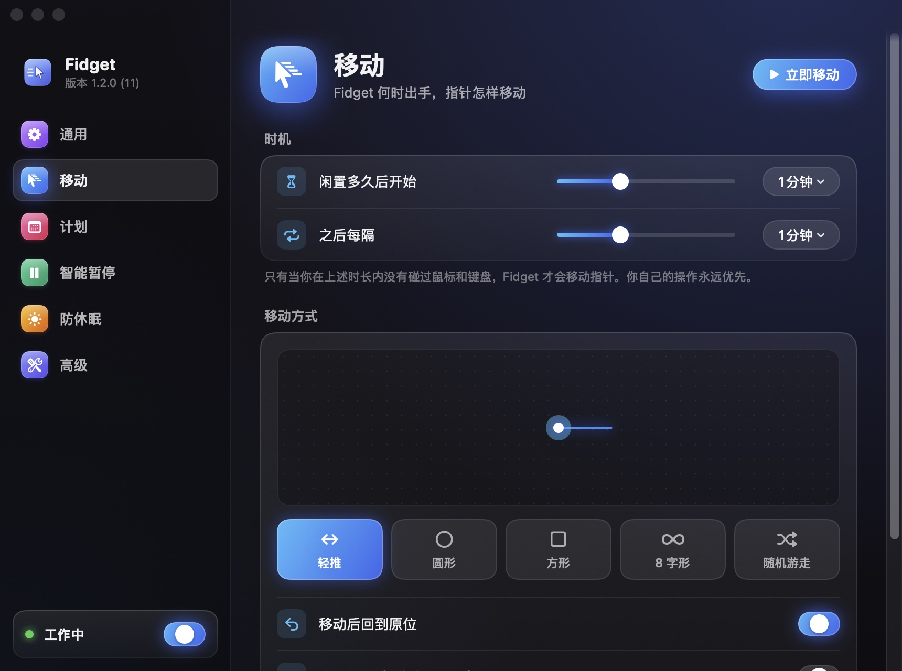
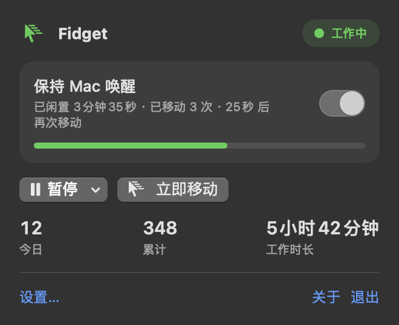
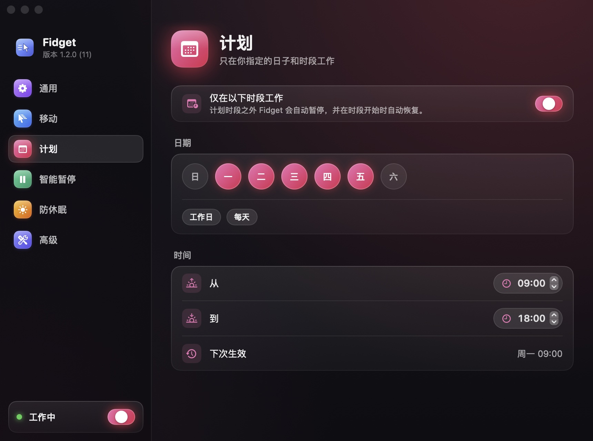
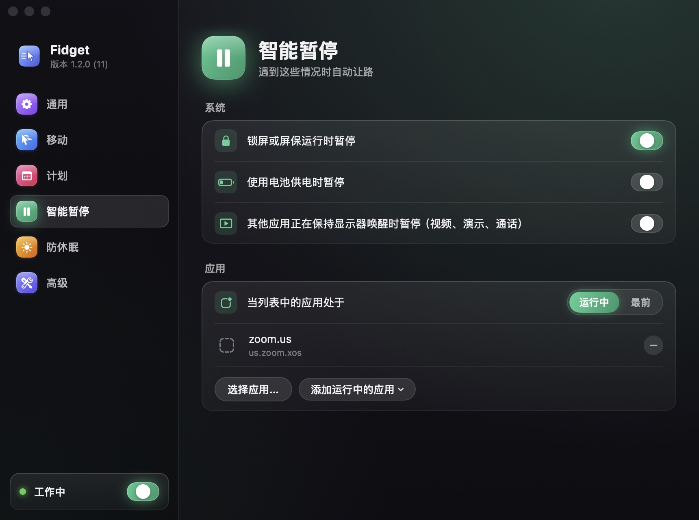
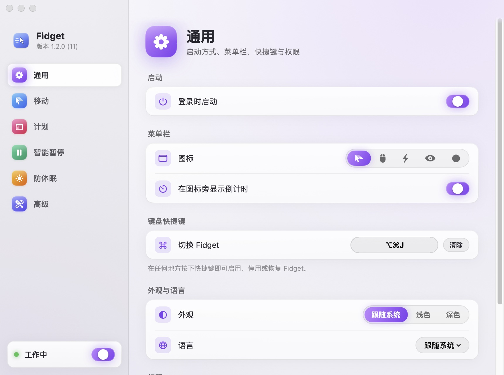
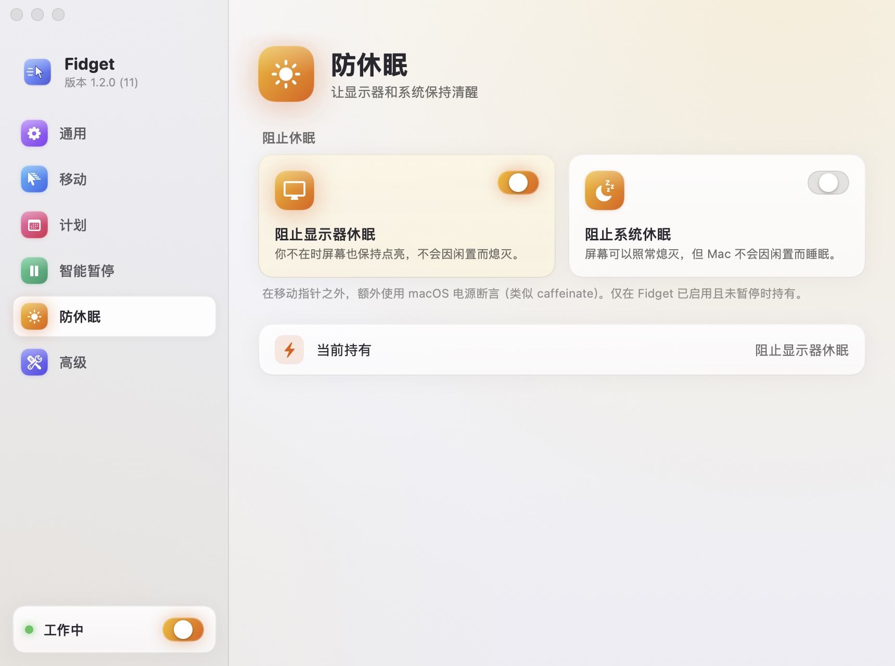

<p align="center">
  
</p>

<h1 align="center">Fidget</h1>

<p align="center">闲时轻轻移动鼠标，让 Mac 保持唤醒、让你的在线状态保持绿色。<br>
仅支持 Apple Silicon · macOS 11 Big Sur 及以上 · Swift 6 · 零依赖 · 开源（MIT）</p>

<p align="center"><a href="README.md">English</a> · <b>简体中文</b></p>

Fidget 是 [automatic-mouse-mover](https://github.com/prashantgupta24/automatic-mouse-mover) 的精神续作：原项目用 Go + robotgo 实现，随着 Intel Mac 淡出而停止维护。Fidget 从零重写为原生 Swift 菜单栏应用，只做一件事并把它做好。

<p align="center">
  
</p>

## 它做什么

- **只在你离开时工作**：你停止操作一段时间（默认 60 秒）后才开始移动指针；你一碰鼠标或键盘立刻停止。Fidget 自己的移动不会被误判成“你回来了”。
- **真正的 HID 事件**：通过 CoreGraphics 投递鼠标事件，系统闲置计时被重置，Slack / Teams / 企业微信之类的“离开”检测会认为你一直在线——这是只阻止休眠的工具（caffeinate、Amphetamine 默认模式）做不到的。
- **可调的一切**：阈值、间隔、五种轨迹（轻推 / 圆 / 方 / 8 字 / 随机游走）、距离、时长、是否回到原位、肉眼不可见的隐形模式。
- **知道什么时候该安静**：锁屏/屏保、电池供电、计划时段（支持跨午夜）、指定应用运行或在最前、其它应用正在播放视频/演示时自动暂停。
- **顺手的防休眠**：可选的显示器/系统休眠断言，只在工作时持有。
- **现代菜单栏体验**：状态图标与倒计时、弹出面板、右键快捷菜单、全局快捷键、首次引导、中英双语、`fidget://` URL 自动化，以及参考 CleanMyMac 设计、有浅色和深色两种外观的设置窗口。
- **安全透明**：不联网、无账号、无第三方依赖；设置是一份可读的 JSON；诊断信息一键拷贝。

## 安装

### 下载

从 [Releases](https://github.com/lacdonlang/fidget/releases) 下载 `Fidget-<版本>.dmg`，拖进“应用程序”。首次启动按引导授予**辅助功能**权限（系统设置 → 隐私与安全性 → 辅助功能）。如果系统设置里 Fidget 的开关已经打开，应用却仍显示未授权（装过签名不同的旧版本时会这样），点面板里的“重置权限”，再重新打开开关。

### 从源码构建

需要 Apple Silicon 与 Xcode 16 或更新版本（或同版本 Command Line Tools）。

应用支持 Apple Silicon 能运行的所有 macOS（11 Big Sur 起）。注意：Xcode 27 最低只能部署到 macOS 12，用它在本地构建的应用需要 macOS 12+；正式发布由 CI 挑选能部署到 macOS 11 的 Xcode 构建（`scripts/select-xcode.sh`）。本地可用 `make check-min-os` 按 macOS 11 检查 API 可用性。

```bash
git clone https://github.com/lacdonlang/fidget.git && cd fidget
make app          # → build/Fidget.app（ad-hoc 签名，可本机运行）
make run          # 构建 debug 版并启动
make test         # 全部测试
```

用自己的 Developer ID 签名、公证、打 DMG：

```bash
export CODESIGN_IDENTITY="Developer ID Application: 你的名字 (TEAMID)"
make app notarize dmg
```

在 Xcode 中打开：`make xcodeproj && open Fidget.xcodeproj`（需要 `brew install xcodegen`），或直接 `open Package.swift`。详见 [docs/SIGNING.md](docs/SIGNING.md)。

## 使用

<p align="center">
  
</p>

| 操作 | 方式 |
| --- | --- |
| 开关 | 面板大开关 · 右键菜单 · 全局快捷键 · `open fidget://toggle` |
| 暂停 15 分钟 / 30 分钟 / 1 小时 / … / 今天剩余时间 / 直到恢复 | 面板“暂停”菜单 · 右键菜单 · `open "fidget://pause?minutes=30"` |
| 立即移动一次（测试权限） | 面板“立即移动” · `open fidget://move` |
| 打开设置 | 面板 ⌘, · `open fidget://settings` |

菜单栏图标含义：工作中（实心/运动线）、监测中（普通）、已暂停（暂停符号）、需要权限（警告三角）、已关闭（半透明）。

## 截图

| 通用 | 计划 |
| --- | --- |
|  |  |

| 智能暂停 | 高级 |
| --- | --- |
|  |  |

浅色外观（设置 → 通用 → 外观：跟随系统 / 浅色 / 深色）：

| 通用 | 防休眠 |
| --- | --- |
|  |  |

截图由 `make screenshots` 自动生成（应用内渲染，不依赖屏幕录制权限），每种语言、每种外观各一套。

## 文档

- [架构设计](docs/ARCHITECTURE.md)：分层、状态机、合成事件识别、并发模型、决策记录
- [功能规格](docs/FEATURES.md)：每个功能的行为、默认值与边界
- [测试策略](docs/TESTING.md)：分层测试、用例清单、手动验收
- [签名与发布](docs/SIGNING.md)：证书、公证、CI、TCC 注意事项

## 项目结构

```
Package.swift            SwiftPM（代码与测试的唯一真源）
Sources/FidgetCore       纯逻辑：设置、状态机、轨迹、计划表、规则、统计
Sources/FidgetSystem     macOS 适配：CGEvent、IOKit、锁屏、权限、登录项、快捷键、持久化、日志
Sources/FidgetApp        SwiftUI 界面、菜单栏控制器、组合根、本地化资源
Sources/Fidget           可执行入口
Tests/                   Swift Testing：核心单测、系统集成测试、应用层测试
Resources/               Info.plist、entitlements、图标与 asset catalog
scripts/                 构建 / 签名 / 公证 / DMG / 图标 / 冒烟测试 / 截图
project.yml              XcodeGen 配置（生成 Fidget.xcodeproj）
```

## 为什么不上 App Store

App Store 要求沙盒，而沙盒应用拿不到辅助功能权限，也就无法投递真实的鼠标事件。沙盒里只能用 `CGWarpMouseCursorPosition` + 电源断言，那样能防休眠，但聊天软件仍会判定你离开。因此 Fidget 通过 Developer ID 签名 + 公证分发。代码里的 `PointerControlling` 协议为将来的沙盒降级版留了替换点。

## 致谢

灵感来自 [Prashant Gupta 的 Automatic Mouse Mover](https://github.com/prashantgupta24/automatic-mouse-mover)。MIT 许可证。
